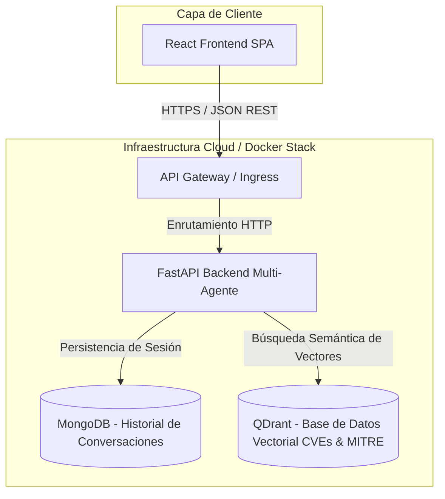
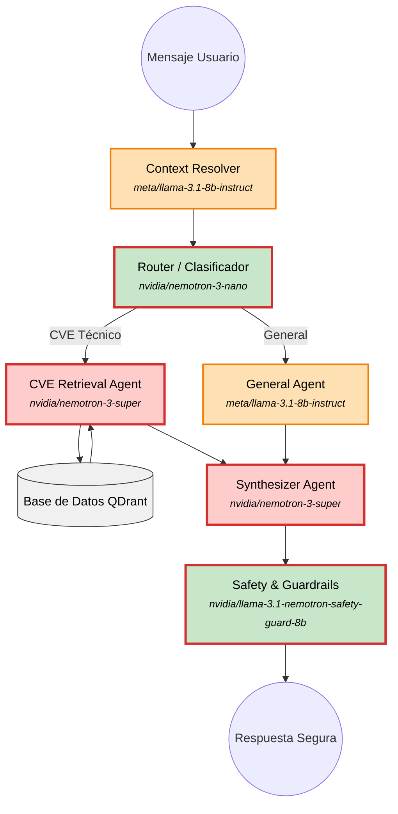

# CyberGuard: Asistente Inteligente de Ciberseguridad Cloud-Native

## 1. Descripción del Dominio y Casos de Uso

### Problema de Negocio

La ciberseguridad suele ser un terreno exclusivo para expertos técnicos debido a la complejidad de la jerga asociada a bases de datos de vulnerabilidades (CVEs) y marcos tácticos de amenazas (como MITRE ATT&CK). Los usuarios de a pie, pequeños empresarios y profesionales sin perfil técnico sufren brechas de seguridad cotidianas por no disponer de orientación accesible, contextualizada y en tiempo real para interpretar alertas o mitigar riesgos específicos.

### Solución Cloud-Native

**CyberGuard** es un sistema multiagente inteligente y nativo de la nube que democratiza el acceso a la inteligencia de amenazas. Utilizando un stack tecnológico moderno desacoplado (FARM: FastAPI, React, MongoDB, QDrant), el sistema procesa consultas en lenguaje natural, realiza búsquedas semánticas sobre vectores de ataque y genera explicaciones prácticas y guiadas para mitigar riesgos.

### Casos de Uso Principales

* **Consulta Ciudadana de Amenazas:** Un usuario particular consulta si una vulnerabilidad específica aparecida en los medios afecta a sus dispositivos domésticos y cómo solucionarla en palabras sencillas.
* **Orientación a PyMEs:** Un administrador de sistemas de una pequeña empresa busca directrices basadas en MITRE ATT&CK para frenar un vector de ataque detectado en su red.
* **Historial de Conversaciones Contextual:** Seguimiento de múltiples hilos de análisis técnico y recomendaciones de seguridad almacenados de forma persistente.
* **Consultas de tácticas y vulnerabilidades:** Permite acceder a las vulnerabilidades y tácticas de ciberseguridad indexadas en la BDD vectorial.
* **Generación de reportes:** Permite a los usuarios crear reportes de ciberseguridad a partir de una conversación con CyberGuard. Permitiendo consultar de forma directa y resumida los problemas objeto de la conversación y sus respectivas soluciones.

---

## 2. Justificación NIST SP 800-145 (Características Cloud)

CyberGuard aprovecha las cinco características esenciales del modelo de computación en la nube definido por el NIST:

* **Autoservicio bajo demanda (*On-Demand Self-Service*):** Mediante la infraestructura contenerizada con Docker y despliegues automatizados, los recursos de cómputo (instancias de FastAPI y nodos de base de datos) se provisionan automáticamente según la demanda sin intervención manual del proveedor.
* **Acceso amplio a la red (*Broad Network Access*):** La aplicación expone interfaces REST accesibles a través de protocolos estándar HTTP/HTTPS desde cualquier dispositivo (navegadores web, móviles o aplicaciones cliente de terceros).
* **Asignación común de recursos (*Resource Pooling*):** Los componentes del stack tecnológico comparten recursos físicos de infraestructura subyacente de forma multi-inquilino (*multi-tenant*), optimizando el uso de CPU, memoria y almacenamiento vectorial en QDrant.
* **Rápida elasticidad (*Rapid Elasticity*):** La arquitectura basada en microservicios permite escalar horizontalmente las instancias del backend de IA y FastAPI de forma independiente ante picos imprevistos de consultas sobre nuevas vulnerabilidades críticas de zero-day.
* **Servicio medido (*Measured Service*):** Los contenedores y la plataforma de despliegue monitorizan de forma continua métricas de uso de recursos (latencia de API, consumo de tokens de vectores, uso de almacenamiento en MongoDB y Qdrant) para la optimización de costes y rendimiento.

---

## 3. Mapeo de Actores NIST SP 500-292 (Cloud Computing Reference Architecture)

| Rol NIST SP 500-292 | Entidad en CyberGuard | Descripción e Impacto Económico |
| --- | --- | --- |
| **Consumidor (*Cloud Consumer*)** | Usuarios particulares, empleados y administradores de PyMEs. | Utilizan la plataforma para resolver dudas de ciberseguridad. **Impacto económico:** Reduce drásticamente los costes de consultoría inicial y formación en ciberseguridad básica. |
| **Proveedor Saas (*Cloud Provider*)** | El subsistema multi-agente de FastAPI y la pasarela de enrutamiento/API Gateway. | Gestiona, negocia y optimiza la entrega de servicios entre el usuario y los almacenes de datos, realizando la orquestación semántica de las consultas hacia Qdrant y MongoDB. **Impacto Económico:** Optimiza el uso de modelos de lenguaje y reduce la latencia de respuesta, controlando los costes operativos de procesamiento cognitivo. |
| **Proveedor Iaas (*Cloud Provider*)** | Proveedor de infraestructura cloud (ej. Google Cloud). | Aloja los clústeres de contenedores y servicios gestionados. **Impacto económico:** Modelo de pago por uso (*Pay-as-you-go*), eliminando costes fijos de adquisición de hardware. |
| **Operador (*Cloud Operator*)** | Redes de distribución de contenido (CDN), proveedores de red de telecomunicaciones e ISPs de los usuarios.| Actúa como transportador de conectividad, garantizando la transmisión segura de los paquetes de datos bajo protocolos cifrados (HTTPS) desde la infraestructura cloud hasta el navegador del consumidor. **Impacto Económico:** Asegura la disponibilidad global y de baja latencia del servicio con redundancia en las rutas de red.|
| **Auditor (Cloud Auditor)** | Rol todavía por asignar (Prevista la integración futura de herramientas automatizadas tipo Dependabot o analistas de seguridad).	| Rol actualmente pendiente de asignación formal en esta fase de desarrollo. Su propósito futuro será evaluar de forma independiente la seguridad de las dependencias, la integridad del código fuente y el cumplimiento de las normativas de privacidad. **Impacto Económico:** Al ser un rol por asignar, la supervisión actual depende de revisiones manuales, posponiendo la automatización de la detección temprana de brechas en librerías de terceros.|

---

## 4. Diagrama de Arquitectura

El siguiente diagrama formal detalla los componentes del sistema, los protocolos de comunicación y las capas de almacenamiento:



---

## 5. Especificación de API REST

A continuación se documentan los endpoints principales de la API REST del backend de CyberGuard, agrupados por dominios funcionales y similitud de proceso (gestión de conversaciones, marco MITRE, base de conocimiento CVEs y generación de reportes).

---

### 5.1. Gestión de Conversaciones

#### Crear una nueva conversación

* **Ruta:** `POST /api/conversaciones`
* **Descripción:** Inicializa una nueva sesión de chat en la base de datos MongoDB.
* **Payload Request (JSON):**

```json
{
  "usuario_id": "usr_981273",
  "titulo": "Consulta sobre vulnerabilidad Apache"
}

```

* **Respuesta Exitosa (`201 Created`):**

```json
{
  "conversacion_id": "conv_67a8b9c1",
  "creation_date": "2026-10-12T10:00:00Z",
  "estado": "activo"
}

```

#### Añadir un mensaje a la conversación

* **Ruta:** `POST /api/conversaciones/{conversacion_id}`
* **Descripción:** Envía un mensaje del usuario y registra la respuesta generada por el agente inteligente en la conversación indicada.
* **Payload Request (JSON):**

```json
{
  "role": "usuario",
  "content": "¿Cómo puedo mitigar la vulnerabilidad CVE-2021-44228 en mi servidor?"
}

```

* **Respuesta Exitosa (`200 OK`):**

```json
{
  "mensaje_id": "msg_001",
  "conversacion_id": "conv_67a8b9c1",
  "respuesta_agente": "Para mitigar Log4Shell (CVE-2021-44228), debes actualizar la librería Log4j a la versión 2.15.0 o superior...",
  "referencias_mitre": ["T1190", "T1078"],
  "timetag": "2026-10-12T10:01:15Z"
}

```

#### Obtener el historial de una conversación

* **Ruta:** `GET /api/conversaciones/{conversacion_id}`
* **Descripción:** Muestra el historial completo de mensajes asociados a una conversación específica.
* **Payload Request (JSON):**

```json
{
}

```

* **Respuesta Exitosa (`200 OK`):**

```json
{
  "conversacion_id": "conv_67a8b9c1",
  "messages": [
    {
      "role": "usuario",
      "content": "¿Qué es el vector de ataque T1190?",
      "timestamp": "2026-10-12T09:55:00Z"
    },
    {
      "role": "agente",
      "content": "El vector T1190 se refiere a Explotación de Aplicaciones Públicas...",
      "timestamp": "2026-10-12T09:55:05Z"
    }
  ]
}

```

#### Editar mensaje en conversación

* **Ruta:** `POST /api/conversaciones/{conversacion_id}/{message_id}`
* **Descripción:** Permite editar un mensaje seleccionado del usuario, eliminando automáticamente los mensajes posteriores de la secuencia y generando una nueva respuesta actualizada del sistema.
* **Payload Request (JSON):**

```json
{
  "new_content": "¿Cómo puedo mitigar esta vulnerabilidad en versiones antiguas de OpenSSL?"
}

```

* **Respuesta Exitosa (`200 OK`):**

```json
{
  "conversacion_id": "conv_67a8b9c1",
  "mensaje_editado_id": "msg_002",
  "nueva_respuesta_agente": "Para OpenSSL en versiones antiguas, se recomienda actualizar a...",
  "timestamp": "2026-10-12T11:00:00Z"
}

```

#### Eliminar una conversación

* **Ruta:** `POST /api/conversaciones/{conversacion_id}/delete`
* **Descripción:** Elimina la conversación especificada por su identificador único de la base de datos MongoDB, borrando de forma permanente todo el historial de mensajes asociado a dicha sesión.
* **Payload Request (JSON):**

```json
{
}

```

* **Respuesta Exitosa (`200 OK`):**

```json
{
  "estado": "exito",
  "mensaje": "La conversación ha sido eliminada correctamente.",
  "conversacion_id": "conv_67a8b9c1"
}

```

---

### 5.2. Marco MITRE ATT&CK

#### Listar Tácticas MITRE

* **Ruta:** `GET /api/mitre/tacticas`
* **Descripción:** Permite consultar el listado completo de tácticas y categorías principales del marco MITRE ATT&CK indexadas en la base de datos vectorial para su exploración educativa.
* **Payload Request (JSON):**

```json
{
}

```

* **Respuesta Exitosa (`200 OK`):**

```json
{
  "tacticas": [
    {
      "id": "TA0001",
      "nombre": "Initial Access",
      "descripcion": "Técnicas utilizadas por los atacantes para entrar en una red."
    }
  ]
}

```

#### Consultar Detalle de una Técnica MITRE

* **Ruta:** `GET /api/mitre/tecnicas/{tecnica_id}`
* **Descripción:** Consulta los detalles técnicos específicos, descripción y mitigaciones recomendadas de una técnica concreta del marco MITRE ATT&CK (ej. `T1190`).
* **Payload Request (JSON):**

```json
{
}

```

* **Respuesta Exitosa (`200 OK`):**

```json
{
  "tecnica_id": "T1190",
  "nombre": "Exploit Public-Facing Application",
  "descripcion": "Los atacantes pueden intentar aprovechar una vulnerabilidad en un servicio accesible desde Internet...",
  "mitigaciones": [
    "Mantener el software actualizado",
    "Implementar un WAF"
  ]
}

```

---

### 5.3. Inteligencia de Amenazas (CVEs)

#### Listar CVEs Educativos

* **Ruta:** `GET /api/cves`
* **Descripción:** Devuelve un listado general de los CVEs (vulnerabilidades y exposiciones comunes) indexados en la base de datos vectorial, ideal para que los usuarios puedan revisarlos y educarse.
* **Payload Request (JSON):**

```json
{
}

```

* **Respuesta Exitosa (`200 OK`):**

```json
{
  "cves": [
    {
      "cve_id": "CVE-2021-44228",
      "severidad": "Crítica",
      "resumen": "Vulnerabilidad en Apache Log4j2 que permite RCE."
    }
  ]
}

```

#### Consultar Detalle de un CVE Específico

* **Ruta:** `GET /api/cves/{cve}`
* **Descripción:** Devuelve la información detallada de un CVE indexado específico, permitiendo al usuario consultarlo directamente cuando el chatbot lo referencia en una conversación.
* **Payload Request (JSON):**

```json
{
}

```

* **Respuesta Exitosa (`200 OK`):**

```json
{
  "cve_id": "CVE-2021-44228",
  "severidad": "Crítica",
  "cvss_score": 10.0,
  "descripcion_simple": "Fallo crítico en Log4j que permite ejecución remota de código sin autenticación.",
  "mitigacion_recomendada": "Actualizar Log4j a >= 2.15.0 o establecer la propiedad log4j2.formatMsgNoLookups=true."
}

```

---

### 5.4. Gestión de Reportes

#### Exportar Reporte de Conversación

* **Ruta:** `POST /api/reportes/exportar`
* **Descripción:** Genera y descarga un informe estructurado (en formato Markdown o PDF) basado en el contenido de una conversación o análisis de ciberseguridad previo.
* **Payload Request (JSON):**

```json
{
  "conversacion_id": "conv_67a8b9c1",
  "formato": "markdown"
}

```

* **Respuesta Exitosa (`200 OK`):**

```json
{
  "reporte_id": "rep_998877",
  "titulo": "Informe de Mitigación - Log4Shell",
  "contenido_markdown": "# Informe de Ciberseguridad\n...",
  "url_descarga": "/api/reportes/download/rep_998877"
}

```

#### Consultar Historial de Reportes

* **Ruta:** `GET /api/reportes/`
* **Descripción:** Muestra un panel en formato resumido con el listado de todos los reportes generados de las conversaciones anteriores del usuario.
* **Payload Request (JSON):**

```json
{
}

```

* **Respuesta Exitosa (`200 OK`):**

```json
{
  "reportes": [
    {
      "reporte_id": "rep_998877",
      "titulo": "Informe de Mitigación - Log4Shell",
      "creation_date": "2026-10-12T10:30:00Z"
    }
  ]
}

```

## 6. Especificación de flujo agéntico

El flujo agéntico de **CyberGuard** implementa una arquitectura modular y eficiente basada en LangGraph que, mediante una estrategia de cascada de modelos (*model cascading*), optimiza un presupuesto de tokens ajustado sin sacrificar precisión ni seguridad. Desde la reescritura inicial del contexto y la clasificación inteligente del enrutador, las peticiones se dirigen dinámicamente hacia agentes especializados en vulnerabilidades técnicas (con soporte RAG en Qdrant) o en asesoramiento general, para luego ser procesadas por un sintetizador y auditadas por un filtro final de *guardrails*, garantizando así respuestas precisas, rentables y seguras para el usuario.



## Explicación de la Arquitectura de Agentes y Model Cascading

Para optimizar al máximo el presupuesto limitado de **CyberGuard** sin sacrificar la precisión ni la seguridad, la arquitectura implementa una estrategia de **Model Cascading**. Esto permite asignar modelos ligeros a tareas repetitivas o de control, y modelos potentes únicamente a las fases de razonamiento crítico.

---

### Listado y Desglose de Nodos

#### Context Resolver

* **Rol:** Analiza el historial reciente de la conversación para reescribir la pregunta actual del usuario, dotándola de contexto conversacional (por ejemplo, interpretando a qué se refiere si dice *"¿tiene parche?"*).
* **Modelo:** `meta/llama-3.1-8b-instruct`
* **Por qué se usa:** Ofrece un balance óptimo (nivel medio de tokens y criticidad moderada) para procesar texto histórico sin encarecer innecesariamente la entrada.

#### Router / Clasificador

* **Rol:** Evalúa la intención del mensaje para decidir si debe derivarse al especialista en vulnerabilidades técnicas o al asesor general de seguridad.
* **Modelo:** `nvidia/nemotron-3-nano`
* **Por qué se usa:** Es un modelo ultra ligero y de bajísimo coste. Como su única tarea es clasificar la entrada y devolver una etiqueta corta, garantiza una velocidad inmediata y ahorra recursos masivos en cada interacción.

#### Retrieval Agent

* **Rol:** Realiza la búsqueda semántica en la base de datos vectorial Qdrant y analiza los fragmentos técnicos de las vulnerabilidades encontradas.
* **Modelo:** `nvidia/nemotron-3-super`
* **Por qué se usa:** Es una tarea de máxima criticidad y consumo denso de información. Se requiere un modelo de gran capacidad de razonamiento para interpretar correctamente los datos de los CVEs y evitar errores técnicos.

#### General Agent

* **Rol:** Atiende dudas conceptuales, de concienciación y buenas prácticas de ciberseguridad que no requieren consultar la base de datos de vulnerabilidades.
* **Modelo:** `meta/llama-3.1-8b-instruct`
* **Por qué se usa:** Proporciona explicaciones claras y fluidas con un consumo de tokens controlado, evitando gastar modelos pesados en charlas generales.

#### Synthesizer Agent

* **Rol:** Combina todo el contexto procesado (ya sea de los CVEs o del asesor general) y redacta la respuesta final estructurada y profesional para la interfaz de React.
* **Modelo:** `nvidia/nemotron-3-super`
* **Por qué se usa:** Al ser la cara visible de CyberGuard ante el usuario, necesita la máxima fluidez, coherencia y precisión redactora de un modelo de alta gama.

#### Safety & Guardrails

* **Rol:** Actúa como auditor final de seguridad, revisando el mensaje generado antes de enviarlo para detectar y bloquear posibles *jailbreaks* o instrucciones maliciosas de explotación.
* **Modelo:** `nvidia/llama-3.1-nemotron-safety-guard-8b`
* **Por qué se usa:** Es un modelo especializado nativamente en moderación y seguridad. Ofrece un filtrado estricto y rápido con un coste computacional bajo, protegiendo la plataforma de usos indebidos.