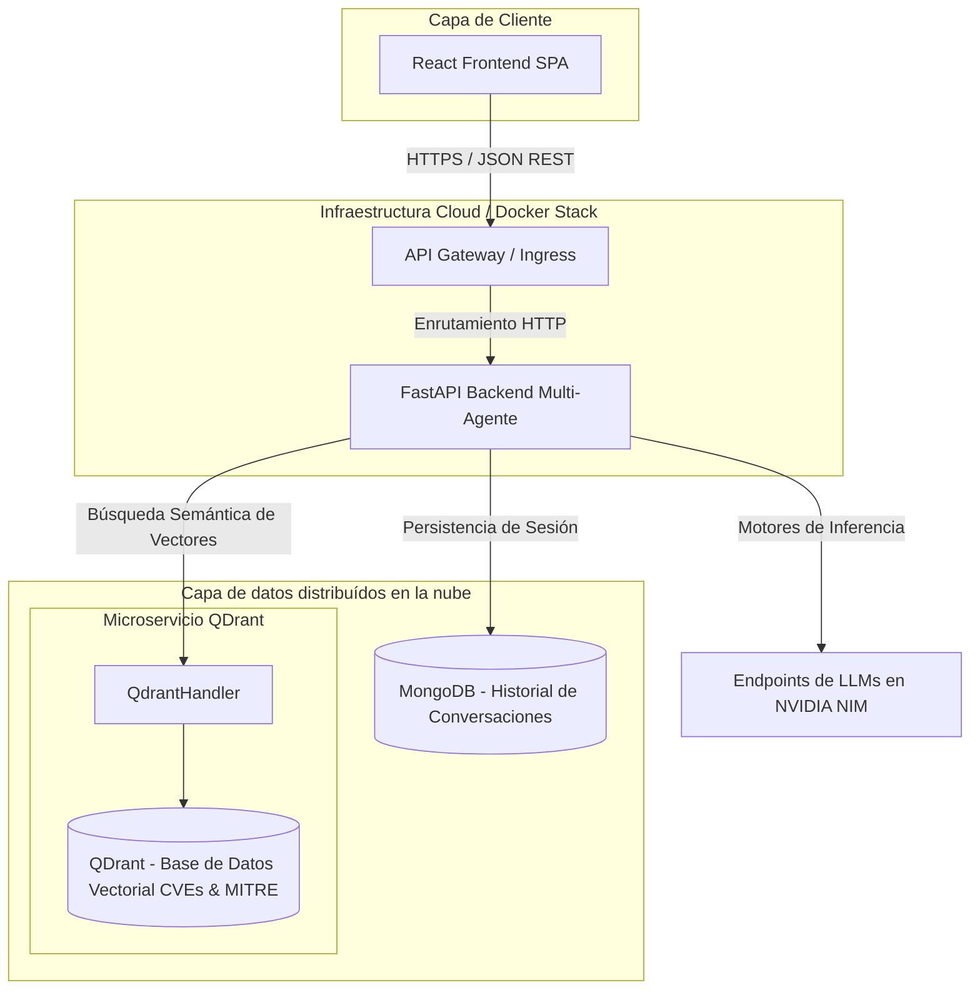
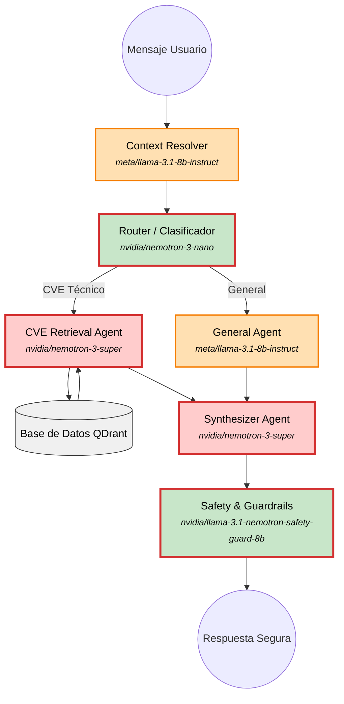

# CyberGuard: Asistente Inteligente de Ciberseguridad Cloud-Native

## 1. Descripción del Dominio y Casos de Uso

### Problema de Negocio

La ciberseguridad suele ser un terreno exclusivo para expertos técnicos debido a la complejidad de la jerga asociada a bases de datos de vulnerabilidades (CVEs) y marcos tácticos de amenazas (como MITRE ATT&CK). Los usuarios de a pie, pequeños empresarios y profesionales sin perfil técnico sufren brechas de seguridad cotidianas por no disponer de orientación accesible, contextualizada y en tiempo real para interpretar alertas o mitigar riesgos específicos.

### Solución Cloud-Native

**CyberGuard** es un sistema multiagente inteligente y nativo de la nube que democratiza el acceso a la inteligencia de amenazas. Utilizando un stack tecnológico moderno desacoplado (FARM: FastAPI, React, MongoDB, QDrant), el sistema procesa consultas en lenguaje natural, realiza búsquedas semánticas sobre vectores de ataque y genera explicaciones prácticas y guiadas para mitigar riesgos.

### Casos de Uso Principales

* **Consulta Ciudadana de Amenazas:** Un usuario particular consulta si una vulnerabilidad específica aparecida en los medios afecta a sus dispositivos domésticos y cómo solucionarla en palabras sencillas.
* **Orientación a PyMEs:** Un administrador de sistemas de una pequeña empresa busca directrices basadas en MITRE ATT&CK para frenar un vector de ataque detectado en su red.
* **Historial de Conversaciones Contextual:** Seguimiento de múltiples hilos de análisis técnico y recomendaciones de seguridad almacenados de forma persistente.
* **Consultas de tácticas y vulnerabilidades:** Permite acceder a las vulnerabilidades y tácticas de ciberseguridad indexadas en la BDD vectorial.
* **Generación de reportes:** Permite a los usuarios crear reportes de ciberseguridad a partir de una conversación con CyberGuard. Permitiendo consultar de forma directa y resumida los problemas objeto de la conversación y sus respectivas soluciones.

---

## 2. Justificación NIST SP 800-145 (Características Cloud)

CyberGuard aprovecha las cinco características esenciales del modelo de computación en la nube definido por el NIST:

* **Autoservicio bajo demanda (*On-Demand Self-Service*):** Mediante la infraestructura contenerizada con Docker y despliegues automatizados, los recursos de cómputo (instancias de FastAPI y nodos de base de datos) se provisionan automáticamente según la demanda sin intervención manual del proveedor.
* **Acceso amplio a la red (*Broad Network Access*):** La aplicación expone interfaces REST accesibles a través de protocolos estándar HTTP/HTTPS desde cualquier dispositivo (navegadores web, móviles o aplicaciones cliente de terceros).
* **Asignación común de recursos (*Resource Pooling*):** Los componentes del stack tecnológico comparten recursos físicos de infraestructura subyacente de forma multi-inquilino (*multi-tenant*), optimizando el uso de CPU, memoria y almacenamiento vectorial en QDrant.
* **Rápida elasticidad (*Rapid Elasticity*):** La arquitectura basada en microservicios permite escalar horizontalmente las instancias del backend de IA y FastAPI de forma independiente ante picos imprevistos de consultas sobre nuevas vulnerabilidades críticas de zero-day.
* **Servicio medido (*Measured Service*):** Los contenedores y la plataforma de despliegue monitorizan de forma continua métricas de uso de recursos (latencia de API, consumo de tokens de vectores, uso de almacenamiento en MongoDB y Qdrant) para la optimización de costes y rendimiento.

---

## 3. Mapeo de Actores NIST SP 500-292 (Cloud Computing Reference Architecture)

| Rol NIST SP 500-292 | Entidad en CyberGuard | Descripción e Impacto Económico |
| --- | --- | --- |
| **Consumidor (*Cloud Consumer*)** | Usuarios particulares, empleados y administradores de PyMEs. | Utilizan la plataforma para resolver dudas de ciberseguridad. **Impacto económico:** Reduce drásticamente los costes de consultoría inicial y formación en ciberseguridad básica. |
| **Proveedor Saas (*Cloud Provider*)** | El subsistema multi-agente de FastAPI y la pasarela de enrutamiento/API Gateway. | Gestiona, negocia y optimiza la entrega de servicios entre el usuario y los almacenes de datos, realizando la orquestación semántica de las consultas hacia Qdrant y MongoDB. **Impacto Económico:** Optimiza el uso de modelos de lenguaje y reduce la latencia de respuesta, controlando los costes operativos de procesamiento cognitivo. |
| **Proveedor Iaas (*Cloud Provider*)** | Proveedor de infraestructura cloud (ej. Google Cloud). | Aloja los clústeres de contenedores y servicios gestionados. **Impacto económico:** Modelo de pago por uso (*Pay-as-you-go*), eliminando costes fijos de adquisición de hardware. |
| **Operador (*Cloud Operator*)** | Redes de distribución de contenido (CDN), proveedores de red de telecomunicaciones e ISPs de los usuarios.| Actúa como transportador de conectividad, garantizando la transmisión segura de los paquetes de datos bajo protocolos cifrados (HTTPS) desde la infraestructura cloud hasta el navegador del consumidor. **Impacto Económico:** Asegura la disponibilidad global y de baja latencia del servicio con redundancia en las rutas de red.|
| **Auditor (Cloud Auditor)** | Rol todavía por asignar (Prevista la integración futura de herramientas automatizadas tipo Dependabot o analistas de seguridad).	| Rol actualmente pendiente de asignación formal en esta fase de desarrollo. Su propósito futuro será evaluar de forma independiente la seguridad de las dependencias, la integridad del código fuente y el cumplimiento de las normativas de privacidad. **Impacto Económico:** Al ser un rol por asignar, la supervisión actual depende de revisiones manuales, posponiendo la automatización de la detección temprana de brechas en librerías de terceros.|

---

## 4. Diagrama de Arquitectura

El siguiente diagrama formal detalla los componentes del sistema, los protocolos de comunicación y las capas de almacenamiento:



---

## 5. Especificación de API REST Backend

A continuación se documentan los endpoints principales de la API REST del backend de CyberGuard, agrupados por dominios funcionales y similitud de proceso (gestión de conversaciones, marco MITRE, base de conocimiento CVEs y generación de reportes).

---

### 5.1. Gestión de Conversaciones

#### Obtener un listado de conversaciones

* **Ruta:** `POST /api/conversaciones`
* **Descripción:** Devuelve un listado de todas las conversaciones.
* **Payload Request (JSON):**

#### Crear una nueva conversación

* **Ruta:** `POST /api/conversaciones`
* **Descripción:** Inicializa una nueva sesión de chat en la base de datos MongoDB.
* **Payload Request (JSON):**

```json
{
}

```

* **Respuesta Exitosa (`201 Created`):**

```json
{ 
  "conversaciones":[
    {
      "conversacion_id": "conv_67a8b9c1",
      "creation_date": "2026-10-12T10:00:00Z",
      "estado": "activo"        
    },
    {
      "conversacion_id": "conv_67a8b9c2",
      "creation_date": "2026-10-12T11:00:00Z",
      "estado": "activo"        
    },
    ...
  ]
}

```

#### Añadir un mensaje a la conversación

* **Ruta:** `POST /api/conversaciones/{conversacion_id}`
* **Descripción:** Envía un mensaje del usuario y registra la respuesta generada por el agente inteligente en la conversación indicada.
* **Payload Request (JSON):**

```json
{
  "role": "usuario",
  "content": "¿Cómo puedo mitigar la vulnerabilidad CVE-2021-44228 en mi servidor?"
}

```

* **Respuesta Exitosa (`200 OK`):**

```json
{
  "mensaje_id": "msg_001",
  "conversacion_id": "conv_67a8b9c1",
  "respuesta_agente": "Para mitigar Log4Shell (CVE-2021-44228), debes actualizar la librería Log4j a la versión 2.15.0 o superior...",
  "referencias_mitre": ["T1190", "T1078"],
  "timetag": "2026-10-12T10:01:15Z"
}

```

#### Obtener el historial de una conversación

* **Ruta:** `GET /api/conversaciones/{conversacion_id}`
* **Descripción:** Muestra el historial completo de mensajes asociados a una conversación específica.
* **Payload Request (JSON):**

```json
{
}

```

* **Respuesta Exitosa (`200 OK`):**

```json
{
  "conversacion_id": "conv_67a8b9c1",
  "messages": [
    {
      "role": "usuario",
      "content": "¿Qué es el vector de ataque T1190?",
      "timestamp": "2026-10-12T09:55:00Z"
    },
    {
      "role": "agente",
      "content": "El vector T1190 se refiere a Explotación de Aplicaciones Públicas...",
      "timestamp": "2026-10-12T09:55:05Z"
    }
  ]
}

```

#### Editar mensaje en conversación

* **Ruta:** `POST /api/conversaciones/{conversacion_id}/{message_id}`
* **Descripción:** Permite editar un mensaje seleccionado del usuario, eliminando automáticamente los mensajes posteriores de la secuencia y generando una nueva respuesta actualizada del sistema.
* **Payload Request (JSON):**

```json
{
  "new_content": "¿Cómo puedo mitigar esta vulnerabilidad en versiones antiguas de OpenSSL?"
}

```

* **Respuesta Exitosa (`200 OK`):**

```json
{
  "conversacion_id": "conv_67a8b9c1",
  "mensaje_editado_id": "msg_002",
  "nueva_respuesta_agente": "Para OpenSSL en versiones antiguas, se recomienda actualizar a...",
  "timestamp": "2026-10-12T11:00:00Z"
}

```

#### Eliminar una conversación

* **Ruta:** `POST /api/conversaciones/{conversacion_id}/delete`
* **Descripción:** Elimina la conversación especificada por su identificador único de la base de datos MongoDB, borrando de forma permanente todo el historial de mensajes asociado a dicha sesión.
* **Payload Request (JSON):**

```json
{
}

```

* **Respuesta Exitosa (`200 OK`):**

```json
{
  "estado": "exito",
  "mensaje": "La conversación ha sido eliminada correctamente.",
  "conversacion_id": "conv_67a8b9c1"
}

```

---

### 5.2. Marco MITRE ATT&CK

#### Listar Tácticas MITRE

* **Ruta:** `GET /api/mitre/tacticas`
* **Descripción:** Permite consultar el listado completo de tácticas y categorías principales del marco MITRE ATT&CK indexadas en la base de datos vectorial para su exploración educativa.
* **Payload Request (JSON):**

```json
{
}

```

* **Respuesta Exitosa (`200 OK`):**

```json
{
  "tacticas": [
    {
      "id": "TA0001",
      "nombre": "Initial Access",
      "descripcion": "Técnicas utilizadas por los atacantes para entrar en una red."
    }
  ]
}

```

#### Consultar Detalle de una Técnica MITRE

* **Ruta:** `GET /api/mitre/tecnicas/{tecnica_id}`
* **Descripción:** Consulta los detalles técnicos específicos, descripción y mitigaciones recomendadas de una técnica concreta del marco MITRE ATT&CK (ej. `T1190`).
* **Payload Request (JSON):**

```json
{
}

```

* **Respuesta Exitosa (`200 OK`):**

```json
{
  "tecnica_id": "T1190",
  "nombre": "Exploit Public-Facing Application",
  "descripcion": "Los atacantes pueden intentar aprovechar una vulnerabilidad en un servicio accesible desde Internet...",
  "mitigaciones": [
    "Mantener el software actualizado",
    "Implementar un WAF"
  ]
}

```

---

### 5.3. Inteligencia de Amenazas (CVEs)

#### Listar CVEs Educativos

* **Ruta:** `GET /api/cves`
* **Descripción:** Devuelve un listado general de los CVEs (vulnerabilidades y exposiciones comunes) indexados en la base de datos vectorial, ideal para que los usuarios puedan revisarlos y educarse.
* **Payload Request (JSON):**

```json
{
}

```

* **Respuesta Exitosa (`200 OK`):**

```json
{
  "cves": [
    {
      "cve_id": "CVE-2021-44228",
      "severidad": "Crítica",
      "resumen": "Vulnerabilidad en Apache Log4j2 que permite RCE."
    }
  ]
}

```

#### Consultar Detalle de un CVE Específico

* **Ruta:** `GET /api/cves/{cve}`
* **Descripción:** Devuelve la información detallada de un CVE indexado específico, permitiendo al usuario consultarlo directamente cuando el chatbot lo referencia en una conversación.
* **Payload Request (JSON):**

```json
{
}

```

* **Respuesta Exitosa (`200 OK`):**

```json
{
  "cve_id": "CVE-2021-44228",
  "severidad": "Crítica",
  "cvss_score": 10.0,
  "descripcion_simple": "Fallo crítico en Log4j que permite ejecución remota de código sin autenticación.",
  "mitigacion_recomendada": "Actualizar Log4j a >= 2.15.0 o establecer la propiedad log4j2.formatMsgNoLookups=true."
}

```

---

### 5.4. Gestión de Reportes

#### Exportar Reporte de Conversación

* **Ruta:** `POST /api/reportes/exportar`
* **Descripción:** Genera y descarga un informe estructurado (en formato Markdown o PDF) basado en el contenido de una conversación o análisis de ciberseguridad previo.
* **Payload Request (JSON):**

```json
{
  "conversacion_id": "conv_67a8b9c1",
  "formato": "markdown"
}

```

* **Respuesta Exitosa (`200 OK`):**

```json
{
  "reporte_id": "rep_998877",
  "titulo": "Informe de Mitigación - Log4Shell",
  "contenido_markdown": "# Informe de Ciberseguridad\n...",
  "url_descarga": "/api/reportes/download/rep_998877"
}

```

#### Consultar Historial de Reportes

* **Ruta:** `GET /api/reportes/`
* **Descripción:** Muestra un panel en formato resumido con el listado de todos los reportes generados de las conversaciones anteriores del usuario.
* **Payload Request (JSON):**

```json
{
}

```

* **Respuesta Exitosa (`200 OK`):**

```json
{
  "reportes": [
    {
      "reporte_id": "rep_998877",
      "titulo": "Informe de Mitigación - Log4Shell",
      "creation_date": "2026-10-12T10:30:00Z"
    }
  ]
}

```

## 6. Especificación de flujo agéntico

El flujo agéntico de **CyberGuard** implementa una arquitectura modular y eficiente basada en LangGraph que, mediante una estrategia de cascada de modelos (*model cascading*), optimiza un presupuesto de tokens ajustado sin sacrificar precisión ni seguridad. Desde la reescritura inicial del contexto y la clasificación inteligente del enrutador, las peticiones se dirigen dinámicamente hacia agentes especializados en vulnerabilidades técnicas (con soporte RAG en Qdrant) o en asesoramiento general, para luego ser procesadas por un sintetizador y auditadas por un filtro final de *guardrails*, garantizando así respuestas precisas, rentables y seguras para el usuario.



## Explicación de la Arquitectura de Agentes y Model Cascading

Para optimizar al máximo el presupuesto limitado de **CyberGuard** sin sacrificar la precisión ni la seguridad, la arquitectura implementa una estrategia de **Model Cascading**. Esto permite asignar modelos ligeros a tareas repetitivas o de control, y modelos potentes únicamente a las fases de razonamiento crítico.

---

### Listado y Desglose de Nodos

#### Context Resolver

* **Rol:** Analiza el historial reciente de la conversación para reescribir la pregunta actual del usuario, dotándola de contexto conversacional (por ejemplo, interpretando a qué se refiere si dice *"¿tiene parche?"*).
* **Modelo:** `meta/llama-3.1-8b-instruct`
* **Por qué se usa:** Ofrece un balance óptimo (nivel medio de tokens y criticidad moderada) para procesar texto histórico sin encarecer innecesariamente la entrada.

#### Router / Clasificador

* **Rol:** Evalúa la intención del mensaje para decidir si debe derivarse al especialista en vulnerabilidades técnicas o al asesor general de seguridad.
* **Modelo:** `nvidia/nemotron-3-nano`
* **Por qué se usa:** Es un modelo ultra ligero y de bajísimo coste. Como su única tarea es clasificar la entrada y devolver una etiqueta corta, garantiza una velocidad inmediata y ahorra recursos masivos en cada interacción.

#### Retrieval Agent

* **Rol:** Realiza la búsqueda semántica en la base de datos vectorial Qdrant y analiza los fragmentos técnicos de las vulnerabilidades encontradas.
* **Modelo:** `nvidia/nemotron-3-super`
* **Por qué se usa:** Es una tarea de máxima criticidad y consumo denso de información. Se requiere un modelo de gran capacidad de razonamiento para interpretar correctamente los datos de los CVEs y evitar errores técnicos.

#### General Agent

* **Rol:** Atiende dudas conceptuales, de concienciación y buenas prácticas de ciberseguridad que no requieren consultar la base de datos de vulnerabilidades.
* **Modelo:** `meta/llama-3.1-8b-instruct`
* **Por qué se usa:** Proporciona explicaciones claras y fluidas con un consumo de tokens controlado, evitando gastar modelos pesados en charlas generales.

#### Synthesizer Agent

* **Rol:** Combina todo el contexto procesado (ya sea de los CVEs o del asesor general) y redacta la respuesta final estructurada y profesional para la interfaz de React.
* **Modelo:** `nvidia/nemotron-3-super`
* **Por qué se usa:** Al ser la cara visible de CyberGuard ante el usuario, necesita la máxima fluidez, coherencia y precisión redactora de un modelo de alta gama.

#### Safety & Guardrails

* **Rol:** Actúa como auditor final de seguridad, revisando el mensaje generado antes de enviarlo para detectar y bloquear posibles *jailbreaks* o instrucciones maliciosas de explotación.
* **Modelo:** `nvidia/llama-3.1-nemotron-safety-guard-8b`
* **Por qué se usa:** Es un modelo especializado nativamente en moderación y seguridad. Ofrece un filtrado estricto y rápido con un coste computacional bajo, protegiendo la plataforma de usos indebidos.

## 7. Especificación del microservicio QDrant Handler

### 7.1. Descripción general

El microservicio **QDrant Handler** constituye la capa de gestión, actualización y recuperación de información vectorial de CyberGuard. Su objetivo principal es proporcionar al backend multiagente un mecanismo de acceso eficiente a información contextualizada sobre vulnerabilidades (CVEs) y técnicas y tácticas del framework MITRE ATT&CK mediante búsquedas semánticas.

Este microservicio encapsula toda la lógica relacionada con la base de datos vectorial Qdrant, desacoplando al backend de los mecanismos internos de almacenamiento, generación de embeddings e ingestión de información.

La comunicación entre el backend FastAPI y QDrant Handler se realizará mediante **gRPC**, utilizando Protocol Buffers (Protobuf) para definir los contratos de comunicación y garantizar una interfaz tipada, eficiente y fácilmente extensible.

QDrant Handler se desplegará como un contenedor independiente dentro de la infraestructura Docker, permitiendo su mantenimiento, escalabilidad y evolución de forma desacoplada del resto de componentes del sistema.

### 7.2. Responsabilidades principales

El microservicio QDrant Handler tendrá las siguientes responsabilidades:

**1. Recopilación y actualización de información**

Se encargará de recopilar periódicamente información procedente de fuentes oficiales de ciberseguridad para mantener actualizada la base de conocimiento de CyberGuard.

Entre las principales fuentes de información se contemplan:

- **NVD (National Vulnerability Database):** recopilación de información sobre vulnerabilidades CVE, incluyendo identificadores, descripciones, puntuaciones CVSS, debilidades CWE y referencias asociadas.
- **MITRE ATT&CK:** recopilación de información sobre técnicas, sub-técnicas, tácticas, procedimientos y demás elementos del framework ATT&CK.

El proceso de actualización deberá contemplar la detección de nuevos registros, modificaciones en documentos existentes y eliminación o desactivación de información obsoleta cuando corresponda.

La ingestión se realizará mediante procesos independientes de las operaciones de consulta, evitando que las tareas de sincronización interfieran con las peticiones de los agentes.

**2. Generación de embeddings mediante NVIDIA NIM**

El microservicio será responsable de transformar los documentos recopilados y las consultas recibidas en representaciones vectoriales mediante los endpoints de embeddings de NVIDIA NIM.

Los embeddings permitirán representar semánticamente la información de vulnerabilidades y técnicas MITRE ATT&CK, posibilitando su recuperación mediante similitud vectorial.

Se garantizará la compatibilidad entre los embeddings generados durante la ingestión y los utilizados posteriormente en las consultas, manteniendo la coherencia del modelo, la dimensión y el espacio vectorial de representación.

**3. Gestión de la base de datos vectorial Qdrant**

QDrant Handler será el único componente de la arquitectura responsable de gestionar directamente las operaciones sobre la base de datos vectorial.

Se utilizarán dos colecciones independientes:

- `cyberguard_cves`: almacenamiento de embeddings y metadatos asociados a vulnerabilidades CVE.
- `cyberguard_mitre_attack`: almacenamiento de embeddings y metadatos asociados a técnicas, tácticas y demás elementos de MITRE ATT&CK.

Cada colección permitirá gestionar independientemente sus procesos de ingestión, actualización y recuperación de información.

**4. Recuperación semántica de información**

El microservicio expondrá operaciones de búsqueda semántica para que los agentes del backend puedan recuperar documentos relevantes a partir de consultas expresadas en lenguaje natural.

El procedimiento de recuperación seguirá las siguientes etapas:

1. Recepción de la consulta mediante una petición gRPC.
2. Generación del embedding de la consulta mediante NVIDIA NIM.
3. Selección de la colección correspondiente según el tipo de información solicitada.
4. Ejecución de una búsqueda vectorial en Qdrant.
5. Recuperación de los documentos más similares junto con sus metadatos y puntuaciones de similitud.
6. Devolución de los resultados al backend mediante una respuesta gRPC estructurada.

El número máximo de documentos recuperados podrá configurarse mediante un parámetro `limit`, permitiendo adaptar la recuperación a las necesidades de cada agente.

### 7.3. Interfaz de comunicación

La comunicación entre el backend FastAPI y QDrant Handler se implementará mediante **gRPC sobre HTTP/2**, utilizando Protocol Buffers para definir los mensajes y servicios disponibles.

La interfaz proporcionará, como mínimo, las siguientes operaciones:

| Operación | Descripción |
|---|---|
| `SearchCVEs` | Recuperación semántica de vulnerabilidades CVE. |
| `SearchMITRE` | Recuperación semántica de técnicas y tácticas MITRE ATT&CK. |
| `IngestDocuments` | Incorporación y actualización de documentos en las colecciones correspondientes. |
| `HealthCheck` | Comprobación del estado y disponibilidad del microservicio. |

Las operaciones de ingestión podrán restringirse a los procesos internos de administración, evitando que los agentes de consulta modifiquen directamente la base de conocimiento.

La interfaz gRPC permitirá mantener desacoplados ambos componentes y facilitará futuras ampliaciones de las operaciones disponibles sin modificar la lógica interna del backend.

### 7.4. Arquitectura interna

El microservicio estará organizado en módulos independientes, siguiendo una separación de responsabilidades:

- **QdrantHandler:** componente principal encargado de coordinar las operaciones de recuperación y almacenamiento vectorial.
- **EmbeddingService:** responsable de comunicarse con NVIDIA NIM para generar los embeddings de documentos y consultas.
- **IngestionService:** encargado de recopilar, procesar, normalizar y actualizar la información procedente de las fuentes oficiales.
- **UpdateWorker:** responsable de ejecutar los procesos periódicos de sincronización de las colecciones.
- **GRPCServer:** encargado de exponer las operaciones del microservicio y gestionar las comunicaciones con el backend.

Esta organización permitirá modificar individualmente los mecanismos de ingestión, generación de embeddings y recuperación sin afectar al resto de componentes.

### 7.5. Persistencia y sincronización de información

La base de datos Qdrant actuará como sistema de almacenamiento vectorial especializado en la recuperación semántica de información.

Los documentos almacenados incluirán sus correspondientes embeddings y metadatos, permitiendo identificar el origen, tipo y contenido asociado a cada vector.

**Estrategia de actualización incremental e idempotencia**

Para evitar duplicidades y optimizar los procesos de sincronización, se implementará una estrategia de actualización incremental basada en los identificadores originales de los registros de las fuentes oficiales.

Cada documento dispondrá de un identificador estable derivado de su identificador de origen. Por ejemplo, se utilizarán los identificadores CVE para las vulnerabilidades y los identificadores STIX para los objetos de MITRE ATT&CK.

La incorporación y actualización de documentos se realizará mediante operaciones `upsert` de Qdrant, garantizando que la ejecución repetida de un mismo proceso de ingestión no genere registros duplicados.

El proceso de sincronización seguirá las siguientes etapas:

1. Consulta de las fuentes oficiales para identificar nuevos registros y modificaciones.
2. Comparación de los registros obtenidos con el estado de la última sincronización.
3. Identificación de los documentos nuevos, modificados y obsoletos.
4. Generación de embeddings exclusivamente para los documentos nuevos o cuyo contenido relevante haya cambiado.
5. Incorporación o actualización de los vectores mediante operaciones `upsert`.
6. Gestión de registros obsoletos mediante eliminación o desactivación controlada, según las características de cada fuente.
7. Actualización del estado de sincronización y registro de los resultados del proceso.

Para detectar modificaciones se podrán utilizar marcas temporales de actualización y hashes del contenido normalizado de los documentos.

Esta estrategia permitirá reducir las llamadas a NVIDIA NIM, minimizar las operaciones de escritura en Qdrant y optimizar el tiempo necesario para mantener actualizada la base de conocimiento.

**Disponibilidad durante los procesos de ingestión**

Los procesos de actualización se ejecutarán de manera independiente de las operaciones de consulta, evitando bloquear el servicio de recuperación semántica durante la sincronización de las colecciones.

Se priorizará la actualización incremental de los registros, de manera que las búsquedas puedan continuar operando sobre los vectores existentes mientras se incorporan nuevos documentos o se actualizan los modificados.

En aquellos escenarios que requieran reconstrucciones completas o cambios incompatibles en el modelo de embeddings, se podrá implementar una estrategia de reconstrucción mediante colecciones temporales y posterior sustitución controlada de la colección activa.

De esta manera, se evitará dejar indisponible el servicio de recuperación durante operaciones de mantenimiento o migraciones de los datos vectoriales.

La sincronización deberá garantizar:

- Identificación de registros nuevos y modificados.
- Identificadores estables para evitar duplicidades.
- Actualización idempotente mediante operaciones `upsert`.
- Generación selectiva de embeddings.
- Conservación de la correspondencia entre identificadores de origen y puntos almacenados en Qdrant.
- Gestión controlada de registros obsoletos.
- Registro de la fecha y el resultado de cada sincronización.
- Recuperación ante errores y reintentos de operaciones fallidas.
- Disponibilidad del servicio de búsqueda durante los procesos de actualización.

### 7.6. Monitorización y observabilidad

QDrant Handler incorporará mecanismos de monitorización que permitan supervisar tanto el funcionamiento del microservicio como la calidad y actualidad de la información almacenada.

Se registrarán, como mínimo, las siguientes métricas:

- Número total de documentos almacenados en cada colección.
- Número de documentos nuevos, modificados y eliminados durante cada sincronización.
- Fecha y hora de la última actualización satisfactoria de cada colección.
- Duración de los procesos de ingestión.
- Número de embeddings generados y errores asociados a NVIDIA NIM.
- Número de consultas semánticas procesadas.
- Latencia media de las operaciones de recuperación.
- Errores de comunicación con Qdrant y NVIDIA NIM.

Asimismo, se implementará un sistema de logging que permita identificar errores durante la recopilación, procesamiento, generación de embeddings y almacenamiento de documentos.

Estos mecanismos facilitarán la detección de problemas de disponibilidad, retrasos en la sincronización y posibles inconsistencias en la base de conocimiento.

### 7.7. Despliegue y aislamiento

QDrant Handler se desplegará como un contenedor Docker independiente, conectado a la red interna de servicios de CyberGuard.

El contenedor dispondrá de:

- Aplicación desarrollada en Python.
- Servidor gRPC para atender las peticiones del backend.
- Cliente oficial de Qdrant para interactuar con la base de datos vectorial.
- Cliente HTTP para consumir los endpoints de NVIDIA NIM.
- Procesos de ingestión y actualización de información.
- Configuración mediante variables de entorno.

La base de datos Qdrant dispondrá de almacenamiento persistente mediante volúmenes Docker, garantizando la conservación de las colecciones y sus vectores ante reinicios o recreaciones de los contenedores.

Las credenciales de NVIDIA NIM y los parámetros de conexión se gestionarán mediante variables de entorno, evitando incluir información sensible directamente en el código fuente.

### 7.8. Integración con el backend multiagente

El backend FastAPI no interactuará directamente con la base de datos Qdrant. Todas las operaciones de recuperación semántica se delegarán en QDrant Handler mediante su interfaz gRPC.

De esta manera, los agentes especializados podrán solicitar información contextualizada sin conocer los detalles de implementación de la base de datos vectorial ni del modelo de embeddings utilizado.

Por ejemplo:

- `cve_agent` utilizará `SearchCVEs` para recuperar vulnerabilidades relacionadas semánticamente con una consulta.
- Los agentes especializados en MITRE ATT&CK utilizarán `SearchMITRE` para recuperar técnicas y tácticas relacionadas con un incidente o comportamiento observado.

Los resultados obtenidos se incorporarán al contexto de los agentes para complementar sus capacidades de razonamiento y generación de respuestas.

**En definitiva, QDrant Handler constituye el componente responsable de mantener y proporcionar la memoria vectorial especializada de CyberGuard, actuando como intermediario entre el backend multiagente, los servicios de generación de embeddings de NVIDIA NIM y la base de datos vectorial Qdrant.**